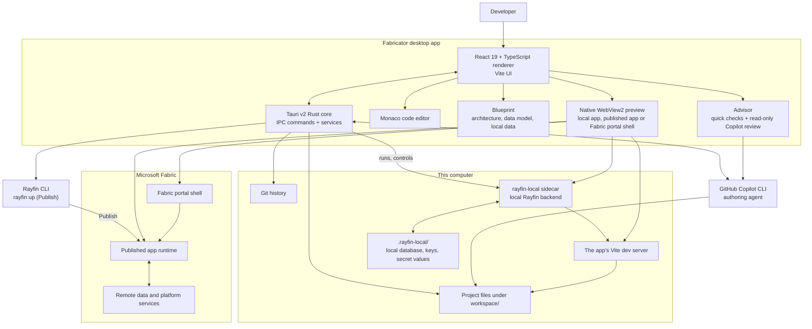

# Contributing to Fabricator

Thanks for your interest in contributing to Fabricator. This is a personal, free-time project maintained by Sachin Patney (GitHub [@spatney](https://github.com/spatney)). The author works at Microsoft, but this is **not** a Microsoft product and is not affiliated with, endorsed by, or supported by Microsoft. Maintenance is best-effort.

Repository: https://github.com/spatney/rayfin-fabricator

## What this project is

Fabricator is a desktop app for Windows and macOS (Apple Silicon) for building "Rayfin apps" via chat. It uses Tauri v2 with a Rust backend and a React 19 + TypeScript renderer built with Vite. It wraps the GitHub Copilot CLI for authoring, runs apps on your computer with rayfin-local, a local Rayfin backend it bundles, and uses each project's Rayfin CLI (`rayfin up`) to publish apps to Microsoft Fabric.

You author locally. Each personal app runs on this computer from the moment it's created. The bundled rayfin-local serves its whole backend (the data API with its policies, sign-in, functions, connectors and storage) and the app's own Vite, and keeps the app's local data in the project's `.rayfin-local/` folder. The preview shows that app, and Copilot checks its work against it with Fabricator's `fabricator_local_status` and `fabricator_local_call` tools. Publishing to Microsoft Fabric is optional: select **Publish**, or turn on **Publish after each chat turn**.

Team apps (the **Team workspaces** experiment) work differently: the team's pipeline publishes each member's preview to Fabric, and during chat turns Fabricator runs the app's Vite locally against that backend. A published app the local backend can't run, such as one with a Kusto connector, previews against its published backend the same way.

## Prerequisites

| Requirement | Notes |
| --- | --- |
| Windows 10/11 or macOS | Windows uses the WebView2 runtime; macOS uses the system WebKit. macOS builds target Apple Silicon (arm64). |
| Node.js 24 LTS and npm | For the renderer and build scripts. Node 22.13+ also works; CI uses 24. |
| Rust stable | Windows: the MSVC toolchain. macOS: the default toolchain plus the Xcode command-line tools. |
| Tauri prerequisites | For local desktop development and packaging. |
| Git | Used for local project history. |
| Network access to GitHub | `npm ci` downloads rayfin-local, the local Rayfin backend Fabricator bundles, from its GitHub release. See [The rayfin-local sidecar](#the-rayfin-local-sidecar). |

You don't need to install the Rayfin CLI or the GitHub Copilot CLI. Each Rayfin project pins its own Rayfin CLI, which Fabricator runs through `npx rayfin`, and the Copilot engine is bundled with the app; you sign in to both from inside Fabricator.

## Development setup

1. Clone the repository.
2. Install dependencies with `npm ci`. It also downloads the rayfin-local sidecar.
3. Start the app with `npm run dev`.

## Useful scripts

| Script | What it does |
| --- | --- |
| `npm run dev` | Runs the Tauri app with the Vite renderer. |
| `npm run build` | Builds the desktop app and its installer (NSIS `.exe` on Windows, `.dmg` and updater bundle on macOS). |
| `npm run dev:renderer` | Runs the renderer development server. |
| `npm run build:renderer` | Builds the renderer. |
| `npm run typecheck` | Runs TypeScript type checking. |
| `npm test` | Runs renderer regression tests (also run in CI). |
| `npm run lint` | Runs lint checks. |
| `npm run format` | Formats code with Prettier. |
| `npm run rayfin-local:fetch` | Downloads the pinned rayfin-local sidecar into `src-tauri/binaries/`. `npm ci`, `npm run dev` and `npm run build` run it too. |

## Verification before opening a PR

Please run:

```powershell
npm run typecheck
npm run lint
npm run build:renderer
```

If you changed Rust code, also run Cargo from `src-tauri`:

```powershell
cd src-tauri
& "$env:USERPROFILE\.cargo\bin\cargo.exe" check
```

Cargo may not be on `PATH`, so the explicit path above is often safest on Windows. Every Cargo build needs the rayfin-local sidecar in `src-tauri/binaries/`: if `npm ci` couldn't download it, run `npm run rayfin-local:fetch` first.

## Project layout

```text
rayfin-fabricator/
├─ src-tauri/                 Rust Tauri backend, IPC commands, services, resources, packaging
│  ├─ src/commands/           IPC handlers: advisor, auth, chat, deploy (publishing), design, doctor, fabric, files, git, local, projects, settings, team, …
│  ├─ src/services/           exec, local_backend (the rayfin-local supervisor), preview, store, telemetry, history, crashlog, emit, paths, team, …
│  ├─ binaries/               The rayfin-local sidecar, downloaded by scripts/rayfin-local (not committed)
│  ├─ windows/                NSIS installer hooks that stop the sidecar before an update or uninstall
│  ├─ vendor/wry/             Vendored wry: upstream crate + the patches in vendor/wry-patches
│  └─ vendor/wry-patches/     WebView2 device-compliance SSO + macOS preview-positioning fix
├─ src/renderer/              React 19 + TypeScript UI built with Vite
│  ├─ screens/                SetupScreen onboarding and Workbench shell
│  └─ components/             ChatPanel, PreviewPane, CodeViewer, DeploymentsControl, AdvisorView, GitControl, SettingsModal, …
├─ src/shared/ipc.ts          Shared TypeScript IPC types
├─ src/shared/advisor/        Advisor rule catalog (rules.json), shared by the renderer and the Rust core
├─ src/shared/docs-links.json Docs pages the app links to (checked by the docs build)
├─ website/                   Documentation site (Next.js + Fumadocs), published to GitHub Pages
├─ scripts/docs-screenshots/  Tooling that captures the docs site's screenshots
├─ scripts/videos/            Videos hosted by Ray: the landing page's intro and the Learn Rayfin with Ray lessons (Remotion + ElevenLabs)
├─ scripts/design-bench/      Times Design mode's AI options per Copilot model, to order the models Design picks
├─ scripts/wry/               Re-vendors wry from crates.io and applies the local patches
├─ scripts/rayfin-local/      Downloads the rayfin-local sidecar that rayfin-local.json pins
├─ docs/                      Maintainer deployment notes and the vendored wry patch write-up
├─ analytics/                 Application Insights KQL queries and notes
├─ resources/                 Runtime resources, including telemetry configuration placeholders
├─ .github/workflows/         CI, the release workflow (Windows NSIS and macOS dmg builds), and the docs site deploy
├─ package.json               npm scripts and renderer dependencies
├─ rayfin-local.json          The rayfin-local release Fabricator bundles, with each archive's SHA-256
└─ logo.png                   Project logo
```

The vendored `wry` patches are documented in [`docs/VENDORED-WRY-PATCH.md`](./docs/VENDORED-WRY-PATCH.md). They enable WebView2 device-compliance SSO, so the embedded preview can sign in to Entra Conditional Access "compliant device" apps, and keep the macOS preview below its toolbar.

## Architecture



A React renderer drives the workbench, chat, editor, Blueprint, preview, publishing, advisor, settings, skills, and history. A Tauri v2 Rust core owns the IPC handlers in `src-tauri/src/commands/` and the services in `src-tauri/src/services/` for running external tools, supervising each project's local backend, persistence, preview hosting, telemetry, history, crash logs, auto-updates, and path management.

Fabricator wraps the tools you'd otherwise run by hand. It drives the GitHub Copilot CLI to author, runs each app on this computer with rayfin-local while you build, shells out to the Rayfin CLI to publish to Microsoft Fabric, tracks your project with git, and loads the running app — on this computer, or published to Fabric — into the embedded preview. Copilot checks the app through Fabricator's `fabricator_local_status` and `fabricator_local_call` tools, and its chat sandbox keeps it out of `.rayfin-local/`. The Advisor closes the loop: instant rule checks plus an on-demand, read-only Copilot review flag issues like unguarded routes, loose database policies, or unbounded text columns, and it tells you when a review has gone stale.

## Documentation site

The user docs at <https://spatney.github.io/rayfin-fabricator/> are built from [`website/`](./website) (Next.js + Fumadocs, static export). `.github/workflows/docs.yml` builds it on pull requests and publishes it to GitHub Pages on every push to `master` that touches the site.

```powershell
cd website
npm install
npm run dev          # http://localhost:3000
npm run check:docs   # content lint
```

- Pages are MDX files in `website/content/docs/`. Read [`website/AGENTS.md`](./website/AGENTS.md), the authoring contract, before writing one.
- Update the docs in the same pull request when you change behavior, setup, UI labels, or messages users see.
- The app links to specific docs pages and headings through `src/shared/docs-links.json`. `npm run verify:app-links` (run by the docs workflow after a build) fails if one of them disappears, so rename a linked page or heading together with that file.
- Screenshots live in `website/public/screenshots/`, captured once per theme: `<id>.webp` in the dark theme and `<id>.light.webp` in the light one. Refresh them with the tooling in [`scripts/docs-screenshots/`](./scripts/docs-screenshots/README.md), which runs an isolated copy of the app and removes personal details.
- The landing page's intro video, hosted by Ray, comes in a dark and a light cut generated by [`scripts/videos/`](./scripts/videos/README.md). Render and publish both again after UI changes that show up in it. The same studio makes the Learn Rayfin with Ray lessons for YouTube.

## Coding conventions

- Keep changes focused and surgical.
- Use TypeScript with the existing ESLint and Prettier setup.
- Run `npm run format` for formatting.
- Rust code uses 2-space indentation.
- Do not include secrets in source code.

## Commit and PR conventions

- Commit messages should be concise, imperative, sentence-case, and have no type prefix.
- Open PRs against https://github.com/spatney/rayfin-fabricator.
- Link related issues where possible.
- Include screenshots or notes for UI changes.
- Update the docs site (`website/content/docs/`) when behavior, setup, or release steps change.

## Vendored wry patches

`src-tauri/vendor/wry` is the upstream `wry` crate plus the patches in `src-tauri/vendor/wry-patches` (WebView2 device-compliance SSO and the macOS preview position). When a Tauri upgrade moves the `wry` version, `cargo test` fails until you re-vendor it with `node scripts/wry/vendor-wry.mjs update <version>`. Change vendored files only through a patch: CI runs `npm run vendor:wry -- verify`. See `docs/VENDORED-WRY-PATCH.md` before changing Tauri or `wry`.

## The rayfin-local sidecar

Fabricator runs [rayfin-local](https://github.com/spatney/rayfin-local) for each open personal project: it serves a Rayfin app and its whole backend locally, and keeps the app's local state in the project's `.rayfin-local/` folder. Fabricator supervises it (`src-tauri/src/services/local_backend/`), keeps its output in memory and under the logs folder with credentials masked, and controls it through its loopback-only control API. It ships inside the app as a Tauri sidecar (`bundle.externalBin` in `src-tauri/tauri.conf.json`): Cargo builds of `src-tauri` copy `src-tauri/binaries/rayfin-local-<target triple>[.exe]` next to the app's executable (for example to `src-tauri/target/debug/rayfin-local.exe`), and the Windows installer and the macOS app bundle install it there too.

- `rayfin-local.json` pins the release and the SHA-256 of each platform's archive. `scripts/rayfin-local/fetch.mjs` downloads the archive, checks it against the pin and unpacks the binary with the system `tar`. A stamp file next to the binary skips the download until the pin changes.
- `npm ci` runs the fetch but only warns when it can't, for example offline, or on Linux, which Fabricator doesn't ship for. `npm run dev`, `npm run build` and `npm run rayfin-local:fetch` fail instead. Add `-- --target <triple>` to fetch for another target, or `-- --force` to download again.
- To bundle a rayfin-local you built, for example while you change both repositories, set `FABRICATOR_RAYFIN_LOCAL_BIN` to its binary and run `npm run rayfin-local:fetch` or `npm run dev`. The fetch copies that binary without checking it, and the app runs the binary the variable names. Unset it and fetch again to go back to the pinned release.
- To move to a new rayfin-local release, set `version` and each target's `archive` and `sha256` in `rayfin-local.json` from the release's `SHA256SUMS.txt`, update `sdk` when the Rayfin versions it supports change, and run `npm run rayfin-local:fetch`.
- The Windows installer and uninstaller stop a rayfin-local that runs from the install folder before they replace or remove it, and leave any other rayfin-local alone (`src-tauri/windows/installer-hooks.nsh`).

## Releases

Pushing a version tag drives `.github/workflows/release.yml`. The release workflow builds the NSIS installer and injects the Application Insights connection string from the `APPINSIGHTS_CONNECTION_STRING` GitHub Actions secret into `resources/telemetry.json` at build time.

`deploy.ps1` is a maintainer-only script that provisions Azure Application Insights and sets that secret.

### Code signing (maintainers)

Release installers are signed with **Azure Trusted Signing** (a.k.a. Azure Artifact Signing) when the required GitHub Actions settings are present. The release workflow signs both the app executable and the NSIS installer through Tauri's `signCommand` and [`artifact-signing-cli`](https://github.com/Levminer/trusted-signing-cli). It signs the rayfin-local sidecar with the same tool and certificate before the build, and afterwards checks that the installer's copy and the one next to the app's executable carry the installer's signature. On macOS, Tauri signs the sidecar inside the app bundle like the app's own executable, and the workflow checks that too. When the signing credentials are absent (forks, PR builds), the installer is still produced — just unsigned — so contributors never need a certificate to build.

To enable signing, set the following on the repository (**Settings → Secrets and variables → Actions**):

| Kind | Name | Value |
| --- | --- | --- |
| Secret | `AZURE_SIGNING_CLIENT_ID` | App registration (client) ID |
| Secret | `AZURE_SIGNING_CLIENT_SECRET` | App registration client secret |
| Secret | `AZURE_SIGNING_TENANT_ID` | Directory (tenant) ID |
| Variable | `AZURE_SIGNING_ENDPOINT` | Region endpoint, e.g. `https://eus.codesigning.azure.net` |
| Variable | `AZURE_SIGNING_ACCOUNT` | Trusted Signing account name |
| Variable | `AZURE_SIGNING_CERT_PROFILE` | Certificate profile name |

The app registration's service principal needs the **Artifact Signing Certificate Profile Signer** role on the signing account. Signing removes the "Unknown Publisher" prompt immediately; Microsoft SmartScreen still builds per-certificate reputation over time, so brand-new releases may show a SmartScreen prompt until enough downloads accrue.

## Issues and pull requests

Please file issues and pull requests at https://github.com/spatney/rayfin-fabricator.
