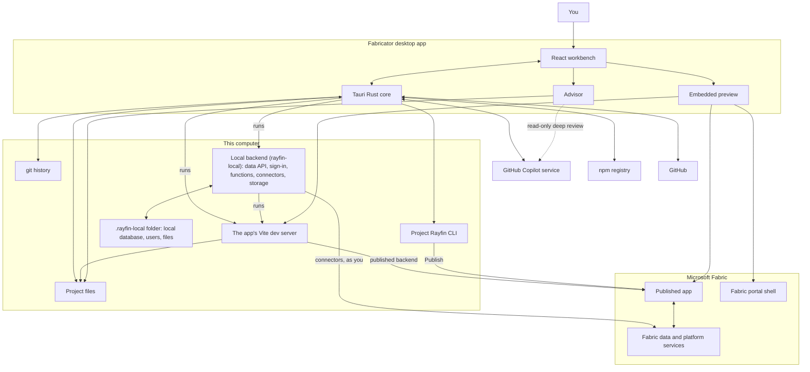

Fabricator wraps the tools you would otherwise run by hand. You describe the app, the built-in GitHub Copilot agent edits a Rayfin project on this computer, Fabricator runs the app and its whole backend on this computer and previews the result, and when you choose, the project's Rayfin CLI publishes it to Microsoft Fabric.

## The loop

1. You create, open, or clone a Rayfin project. A new project starts on the newest Rayfin release the local backend runs, with its `@microsoft/rayfin-*` packages pinned to that minor version, such as `~1.36.0`.
2. When a project opens, Fabricator starts its local backend: the bundled rayfin-local runs the app's data API, sign-in, functions, connectors and storage, and starts the app's own Vite dev server.
3. You type a request in chat.
4. The bundled Copilot engine reads and edits files in the project folder. It doesn't run or publish the app: Fabricator runs it, and publishing is your choice.
5. The local backend picks up each change as Copilot saves it. Vite hot-reloads the frontend, entity changes update the local database, functions rebuild, and changes to `rayfin/rayfin.yml` apply, with a restart of the backend when they need one. A data model change that would delete local data waits for you to decide.
6. Copilot checks its work against the running app with two tools Fabricator gives it, `fabricator_local_status` and `fabricator_local_call`, instead of starting servers itself.
7. The preview shows the app from its Vite dev server, signed in automatically.
8. Fabricator tracks the project with git and saves a version after each chat turn that changes the app, so you can inspect diffs and history and restore earlier versions.
9. When you select **Publish**, Fabricator runs the project-pinned Rayfin CLI (`rayfin up`) to publish the app to a Fabric workspace. **Publish after each chat turn** is off until you turn it on, and then it publishes an app after a turn only once you've published that app yourself.
10. The Advisor runs quick checks locally and can start a read-only Copilot review.

A published app that needs something the local backend can't run, such as a Kusto connector or a Rayfin release outside the local backend's range, previews against its published backend instead. While Copilot works, Fabricator runs the project's Vite dev server on this computer, when the project has Vite installed, configured for the published app's backend with `rayfin env --framework vite`, so the preview shows the frontend changes as Copilot makes them. While **Publish after each chat turn** is off, the dev server keeps running while the app is open. Changes to the data model, permissions and functions reach the app when it's published. The preview shows the published app, or the Fabric portal shell around an app that works only inside it: one that reads semantic models through a `fabric.yaml` file, or is hosted to open only inside Fabric. See [Develop on this computer](/docs/build/local-development).

Team apps, an experiment, work differently: they don't use the local backend. The team's pipeline deploys each member's preview to Fabric, and Fabricator runs the app's Vite dev server against that backend.

## Main pieces

| Piece | Where it runs | What it does |
| --- | --- | --- |
| Desktop UI | Your computer | The React workbench, chat, editor, preview, settings, history, skills, publishing, and Advisor views. |
| Tauri core | Your computer | The Rust layer that runs commands, stores app state, manages paths, handles diagnostics, hosts previews, supervises each project's local backend, and talks to native plugins. |
| GitHub Copilot engine | Bundled with Fabricator, connected to GitHub Copilot | The agent that reads and edits your app when you chat. |
| Project Rayfin CLI | Your project, through `npx rayfin` | Publishes the app and manages Fabric sign-in through the project's pinned Rayfin version. |
| git | Your project folder | Tracks local history, diffs, restores, and team workspace branches. |
| GitHub CLI | Your computer, through `gh` | Team workspace repositories, pull requests and pipeline runs. Each team workspace's `gh` calls and git pushes and fetches use the stored token of the workspace's own GitHub account (`gh auth token --user`), so the CLI's active account doesn't matter. |
| Live preview | Your computer | The app's Vite dev server, run against the app's backend in Fabric: for team apps, and for published apps the local backend can't run. |
| Local backend (rayfin-local) | Your computer, bundled with Fabricator | Runs each personal project's whole Rayfin backend: the data API with its `@role` policies over a local SQLite database, sign-in with a local Fabric sign-in page, functions on Node.js, connectors and storage. It also runs the app's own Vite dev server. Its state is in the project's `.rayfin-local/` folder. |
| Microsoft Fabric | Your tenant | Hosts published apps and their data, Fabric workspaces, capacities, and Fabric app items. |

## Architecture diagram

## The local backend

rayfin-local is a local Rayfin backend: it answers the same requests as an app's backend in Fabric, so the app and its Rayfin SDK run unchanged. Fabricator bundles it next to its own executable, signed like Fabricator, and pins the version each Fabricator release uses. Setup's **Local backend** item checks that it runs. Its source and its full list of [differences from Fabric](https://github.com/spatney/rayfin-local/blob/main/docs/differences.md) are in the [rayfin-local repository](https://github.com/spatney/rayfin-local).

- **One per project.** For each personal project, Fabricator runs `rayfin-local serve --json` in the project folder, with no console window. It reads the backend's events to show its state, keeps its output for **Help** and diagnostics, and restarts it after a crash, up to three times in two minutes. At most two projects run at once: the one you have open and the one before it. When Fabricator exits or installs an update, it stops them all.
- **On this computer only.** The backend listens on `localhost`, by default on port 7171 and the app's Vite dev server on port 5173, and moves to the next free port when one is busy. Fabricator controls it through a control API that answers only on this computer, and only to a secret that changes every time the backend starts.
- **Its own data.** The app's database, local users, stored files, signing keys and local secret values live in the project's `.rayfin-local/` folder. The folder has its own `.gitignore`, so git ignores it, and Copilot's chat can't read or change it. The data starts empty: nothing is copied from a published app, and publishing doesn't copy it to Fabric.
- **Signed in as you.** Apps built from Rayfin's templates sign in automatically, without a sign-in page. They sign in as your Microsoft Entra account from the Azure CLI or, when the Azure CLI isn't signed in, from the Rayfin CLI's sign-in for the Fabric account in use, which Fabricator passes in `RAYFIN_CONFIG_DIR`. With neither, they sign in as a local account, `developer@example.com`. **Preview as** in the preview's toolbar signs the app in as a test user, or signs it out, instead. "Sign in with Fabric" opens a local sign-in window instead of Fabric's, which signs in as the person **Preview as** shows without asking, and asks only when it's **Signed out**.
- **Your Azure access.** Functions' tokens, and connectors to Power BI semantic models, Fabric SQL databases, warehouses and SQL analytics endpoints, run as you, with that same account, even for connections set to application access. A function or query can reach what your account can reach. Kusto connectors run only on Fabric.

## What runs on your computer

Fabricator stores settings, project lists, chat history, Advisor state, logs, and diagnostics exports under the app data folder. Your Rayfin apps live in the workspace folder, which defaults to `RayfinProjects` in your home directory. The logs folder also keeps each project's local backend output, and each app's local data lives in its project's `.rayfin-local/` folder. See [Files and folders](/docs/reference/files).

The desktop app uses Tauri v2: a Rust core with a React renderer. On Windows, the embedded preview uses WebView2. On macOS, it uses the system web view. Your app's Vite dev server and its functions run with the Node.js that setup checks.

## Accounts

Fabricator doesn't keep credentials itself; each tool keeps its own.

- **GitHub Copilot**: the bundled Copilot engine stores the sign-in.
- **Microsoft Fabric**: the Rayfin CLI keeps one signed-in account per config folder, `~/.rayfin` by default. Fabricator gives each Fabric account added after the first its own folder under the app data folder, and points every Rayfin CLI and helper process it starts at the account in use with `RAYFIN_CONFIG_DIR`. Sign-in, sign-out and sign-in checks run the project's pinned Rayfin CLI outside the project folder, because the CLI reads the project's `rayfin.yml` at startup. The project's Fabric environment overrides in `rayfin/.env` still apply.
- **Azure CLI**: the Azure CLI keeps every account you sign in to. Fabricator lists them with `az account list`, switches with `az account set`, signs one out with `az logout --username`, and signs in with `az login --allow-no-subscriptions`, so accounts without an Azure subscription work.
- **GitHub**: the GitHub CLI keeps every account you sign in to. **Add account** runs `gh auth login` in a terminal and then switches back to your default account.
- **Your app on this computer**: the local backend gets its tokens from the Azure CLI or the Rayfin CLI's sign-in, as described in [The local backend](/docs/reference/how-it-works#the-local-backend). It keeps them in memory and never writes them to its output.
- **Your own API keys**: Fabricator keeps each provider's key in Windows Credential Manager or the macOS Keychain, after checking it against the provider's model list. Each Copilot session gets the keys and your chosen models as its own model providers, every time it starts or resumes, so a conversation can switch between Copilot's models and yours. Requests to OpenAI, xAI and Google go through a relay on `127.0.0.1`. It leaves out a reasoning effort the chosen model doesn't take (the runtime asks for one by default), and adapts Google's requests to Gemini's OpenAI-compatible API: it removes request and message fields Gemini rejects, sends back the thought signatures Gemini adds to its tool calls, moves images out of tool results, and numbers the tool calls in Gemini's replies.

When you open Fabricator after setup has passed, it shows your work at once and checks tools and accounts in the background. Each check runs separately, so a slow one, such as Fabric's, doesn't delay the others.

## What goes over the network

Fabricator and the tools it runs can contact these services:

- GitHub Copilot for chat, model access, design options, deep Advisor reviews, and team workspace diagnoses.
- Microsoft Fabric and Rayfin services when you sign in, publish, preview published apps, share apps, or inspect Fabric items.
- GitHub for update checks, release downloads, cloning repositories, issue reporting, and team workspace repositories.
- The npm registry when creating a project from the Rayfin CLI's template and when installing project dependencies. Fabricator also asks it for the newest Rayfin release the local backend runs.
- Power BI, Fabric SQL databases, warehouses and SQL analytics endpoints (over TCP port 1433), and the Azure and Fabric APIs your app's functions call, from the local backend with your own sign-in. The local backend itself listens only on this computer.
- Azure and GitHub APIs for team workspace setup and **Diagnose with Copilot** when the **Team workspaces** experiment is enabled.
- Power BI and Fabric APIs, with the Azure CLI's sign-in, to find and read a Power BI report when the **Migrate Power BI reports** experiment is enabled.
- Anthropic, OpenAI, xAI and Google, when you add your own API keys: to check a key and list its models, and for chat, Advisor and Design requests on a model you chose from them.

## What the Advisor can read

Quick checks run locally against the project snapshot. **Run deep review** starts a read-only Copilot review. That review can read your project and rayfin.ai documentation, but it is not allowed to edit files, run commands, or open `.env` files or the `.rayfin-local` folder.
