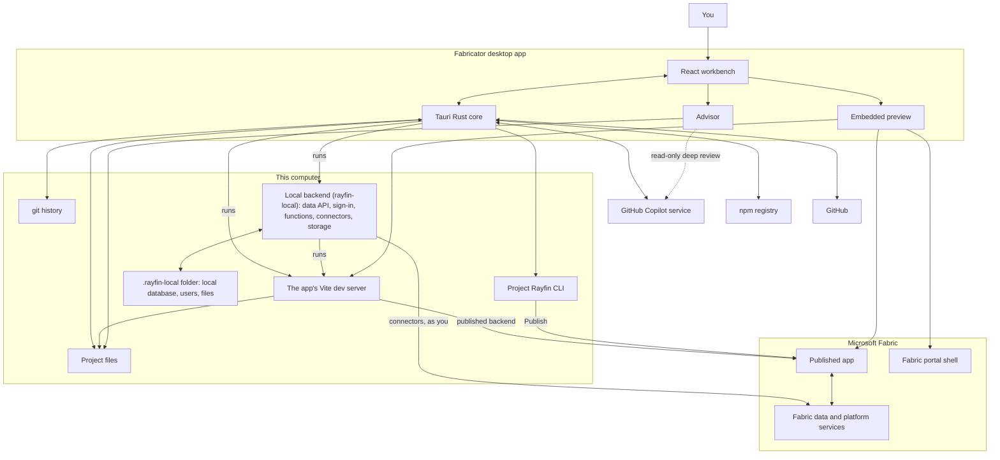

Fabricator wraps the tools you would otherwise run by hand. You describe the app, the built-in GitHub Copilot agent edits a Rayfin project on this computer, Fabricator runs the app and its whole backend on this computer and previews the result, and when you choose, the project's Rayfin CLI publishes it to Microsoft Fabric.

## The loop

1. You create, open, or clone a Rayfin project. A new project starts on the newest Rayfin release the local backend runs, with its `@microsoft/rayfin-*` packages pinned to that minor version, such as `~1.36.0`.
2. When a project opens, Fabricator starts its local backend: the bundled rayfin-local runs the app's data API, sign-in, functions, connectors and storage, and starts the app's own Vite dev server.
3. You type a request in chat.
4. The bundled Copilot engine reads and edits files in the project folder. It doesn't run or publish the app: Fabricator runs it, and publishing is your choice.
5. The local backend picks up each change as Copilot saves it. Vite hot-reloads the frontend, entity changes update the local database, functions rebuild, and changes to `rayfin/rayfin.yml` apply, with a restart of the backend when they need one. A data model change that would delete local data waits for you to decide.
6. Copilot checks its work against the running app with two tools Fabricator gives it, `fabricator_local_status` and `fabricator_local_call`, instead of starting servers itself.
7. The preview shows the app from its Vite dev server, signed in automatically.
8. Fabricator tracks the project with git and saves a version after each chat turn that changes the app, so you can inspect diffs and history and restore earlier versions.
9. When you select **Publish**, Fabricator runs the project-pinned Rayfin CLI (`rayfin up`) to publish the app to a Fabric workspace. **Publish after each chat turn** is off until you turn it on, and then it publishes an app after a turn only once you've published that app yourself.
10. The Advisor runs quick checks locally and can start a read-only Copilot review.

A published app that needs something the local backend can't run, such as a Kusto connector or a Rayfin release older than the local backend's range, previews against its published backend instead. While Copilot works, Fabricator runs the project's Vite dev server on this computer, when the project has Vite installed, configured for the published app's backend with `rayfin env --framework vite`, so the preview shows the frontend changes as Copilot makes them. While **Publish after each chat turn** is off, the dev server keeps running while the app is open. Changes to the data model, permissions and functions reach the app when it's published. The preview shows the published app, or the Fabric portal shell around an app that works only inside it: one that reads semantic models through a `fabric.yaml` file, or is hosted to open only inside Fabric. See [Develop on this computer](/docs/build/local-development).

Team apps, an experiment, work differently: they don't use the local backend. The team's pipeline deploys each member's preview to Fabric, and Fabricator runs the app's Vite dev server against that backend.

## Main pieces

| Piece | Where it runs | What it does |
| --- | --- | --- |
| Desktop UI | Your computer | The React workbench, chat, editor, preview, settings, history, skills, publishing, and Advisor views. |
| Tauri core | Your computer | The Rust layer that runs commands, stores app state, manages paths, handles diagnostics, hosts previews, supervises each project's local backend, and talks to native plugins. |
| GitHub Copilot engine | Bundled with Fabricator, connected to GitHub Copilot | The agent that reads and edits your app when you chat. |
| Project Rayfin CLI | Your project, through `npx rayfin` | Publishes the app and manages Fabric sign-in through the project's pinned Rayfin version. |
| git | Your project folder | Tracks local history, diffs, restores, and team workspace branches. |
| GitHub CLI | Your computer, through `gh` | Team workspace repositories, pull requests and pipeline runs. Each team workspace's `gh` calls and git pushes and fetches use the stored token of the workspace's own GitHub account (`gh auth token --user`), so the CLI's active account doesn't matter. |
| Live preview | Your computer | The app's Vite dev server, run against the app's backend in Fabric: for team apps, and for published apps the local backend can't run. |
| Local backend (rayfin-local) | Your computer, bundled with Fabricator | Runs each personal project's whole Rayfin backend: the data API with its `@role` policies over a local SQLite database, sign-in with a local Fabric sign-in page, functions on Node.js, connectors and storage. It also runs the app's own Vite dev server. Its state is in the project's `.rayfin-local/` folder. |
| Microsoft Fabric | Your tenant | Hosts published apps and their data, Fabric workspaces, capacities, and Fabric app items. |

## Architecture diagram

## The local backend

rayfin-local is a local Rayfin backend: it answers the same requests as an app's backend in Fabric, so the app and its Rayfin SDK run unchanged. Fabricator bundles it next to its own executable, signed like Fabricator, and pins the version each Fabricator release uses. Setup's **Local backend** item checks that it runs. Its source and its full list of [differences from Fabric](https://github.com/spatney/rayfin-local/blob/main/docs/differences.md) are in the [rayfin-local repository](https://github.com/spatney/rayfin-local).

- **One per project.** For each personal project, Fabricator runs `rayfin-local serve --json` in the project folder, with no console window. It reads the backend's events to show its state, keeps its output for **Help** and diagnostics, and restarts it after a crash, up to three times in two minutes. At most two projects run at once: the one you have open and the one before it. When Fabricator exits or installs an update, it stops them all.
- **On this computer only.** The backend listens on `localhost`, by default on port 7171 and the app's Vite dev server on port 5173, and moves to the next free port when one is busy. Fabricator controls it through a control API that answers only on this computer, and only to a secret that changes every time the backend starts.
- **Its own data.** The app's database, local users, stored files, signing keys and local secret values live in the project's `.rayfin-local/` folder. The folder has its own `.gitignore`, so git ignores it, and Copilot's chat can't read or change it. The data starts empty unless you load the project's [seed data](/docs/reference/how-it-works#seed-data): nothing is copied from a published app, and publishing doesn't copy it to Fabric.
- **Signed in as you.** Apps built from Rayfin's templates sign in automatically, without a sign-in page. They sign in as your Microsoft Entra account from the Azure CLI or, when the Azure CLI isn't signed in, from the Rayfin CLI's sign-in for the Fabric account in use, which Fabricator passes in `RAYFIN_CONFIG_DIR`. With neither, they sign in as a local account, `developer@example.com`. **Preview as** in the preview's toolbar signs the app in as a test user, or signs it out, instead. "Sign in with Fabric" opens a local sign-in window instead of Fabric's, which signs in as the person **Preview as** shows without asking, and asks only when it's **Signed out**.
- **Your Azure access.** Functions' tokens, and connectors to Power BI semantic models, Fabric SQL databases, warehouses and SQL analytics endpoints, run as you, with that same account, even for connections set to application access. A function or query can reach what your account can reach. Kusto connectors run only on Fabric.

### Seed data

A project's seed data is in its `rayfin/seed` folder, in the format rayfin-local reads. Its [seed data docs](https://github.com/spatney/rayfin-local/blob/main/docs/seed-data.md) have the details.

| Path | What it holds |
| --- | --- |
| `rayfin/seed/data/<Entity>.json` | An array of rows, each an object of field values, for the entity it's named after. |
| `rayfin/seed/data/<Entity>.csv` | Or a header row of field names, then a row per line. An empty cell leaves its field out. |
| `rayfin/seed/storage/<folder>/` | The files of a storage folder, at their paths in it. |
| `rayfin/seed/storage/<folder>.json` | Optional: each file's owner, content type and fields, by its path. |

- A field left out gets its default, and `id` a new value. Rows refer to each other by `id`, in any order and across files.
- `$developer` stands for the id of your own account, the one apps sign in as automatically, and `$user:<username>` for a local user's, created when the data loads. Files belong to `$developer` unless their `.json` file says otherwise. Text that starts like a placeholder takes one more `$`.
- Loading checks every file and row first, then replaces every entity's rows and every stored file at once, so when something's wrong nothing changes. Local users stay. Fabricator loads the data through the backend's control API, and checks it the same way without changing anything when Copilot asks.
- Saving reads the local data back in the same form, with user ids as placeholders. rayfin-local writes nothing outside `.rayfin-local`, so Fabricator writes the files, then commits `rayfin/seed/data` and `rayfin/seed/storage`.

## Installed apps

An app installed from a `.rayfin` file runs on the same bundled rayfin-local, but on its own, with no Vite dev server. See [Share an app as a file](/docs/ship/app-files).

- **Built once.** The first time it opens, Fabricator installs the app's packages, and rayfin-local builds the app and serves the build from its backend (`rayfin-local serve --static`). Each app keeps a port of its own, from 47100 up, away from your projects' ports. As long as that port stays the same, the next start serves the same build again (`--reuse-build`) instead of building it again. Updating the app builds it again.
- **A window of its own.** The window shows the app from its backend's `localhost` address. Fabricator's own pages are on another origin, so the app can't use Fabricator's commands. Links to other sites open in your browser, and sign-in popups open as they do in the preview. On Windows, each app's window has its own taskbar identity and icon, and a Start menu shortcut opens Fabricator with the app.
- **Apart from your projects.** Installed apps don't count toward the two projects that run at once. Each stops when its window closes, and when Fabricator exits or installs an update. Started only to open apps, Fabricator doesn't show its own window, and exits with the last app's window.

## What runs on your computer

Fabricator stores settings, project lists, chat history, Advisor state, logs, and diagnostics exports under the app data folder. Your Rayfin apps live in the workspace folder, which defaults to `RayfinProjects` in your home directory. The logs folder also keeps each project's local backend output, and each app's local data lives in its project's `.rayfin-local/` folder. See [Files and folders](/docs/reference/files).

The desktop app uses Tauri v2: a Rust core with a React renderer. On Windows, the embedded preview uses WebView2. On macOS, it uses the system web view. Your app's Vite dev server and its functions run with the Node.js that setup checks.

## Accounts

Fabricator doesn't keep credentials itself; each tool keeps its own.

- **GitHub Copilot**: the bundled Copilot engine stores the sign-in.
- **Microsoft Fabric**: the Rayfin CLI keeps one signed-in account per config folder, `~/.rayfin` by default. Fabricator gives each Fabric account added after the first its own folder under the app data folder, and points every Rayfin CLI and helper process it starts at the account in use with `RAYFIN_CONFIG_DIR`. Sign-in, sign-out and sign-in checks run the project's pinned Rayfin CLI outside the project folder, because the CLI reads the project's `rayfin.yml` at startup. The project's Fabric environment overrides in `rayfin/.env` still apply.
- **Azure CLI**: the Azure CLI keeps every account you sign in to. Fabricator lists them with `az account list`, switches with `az account set`, signs one out with `az logout --username`, and signs in with `az login --allow-no-subscriptions`, so accounts without an Azure subscription work.
- **GitHub**: the GitHub CLI keeps every account you sign in to. **Add account** runs `gh auth login` in a terminal and then switches back to your default account.
- **Your app on this computer**: the local backend gets its tokens from the Azure CLI or the Rayfin CLI's sign-in, as described in [The local backend](/docs/reference/how-it-works#the-local-backend). It keeps them in memory and never writes them to its output.
- **Fabric IQ and Work IQ**: when the Copilot engine connects to them, it asks Fabricator for their tokens, because its own sign-in waits for an account window that a background process can't show. Fabric IQ's token comes from the Azure CLI. For Work IQ, Fabricator signs you in in your browser with Microsoft's Work IQ app, the way Microsoft's Work IQ plugin for Copilot CLI does: the sign-in page comes back to `127.0.0.1:12798`. Fabricator keeps the Work IQ tokens in memory until you quit it, turn off the **Work IQ** experiment, or no app's chat has Work IQ on.
- **MCP servers you add**: the values of their environment variables and headers are in Windows Credential Manager or the macOS Keychain, one entry per server (`rayfin-fabricator/mcp/<id>`), never in `studio.json`. A server that asks you to sign in signs in with the Copilot engine's own sign-in: Fabricator asks the engine to start it, opens the sign-in page it returns in your browser, and the page comes back to the engine on `127.0.0.1`. The engine keeps that sign-in in memory for the chat's session only, so each app's chat signs in on its own, and again when its session starts over.
- **Your own API keys**: Fabricator keeps each provider's key in Windows Credential Manager or the macOS Keychain, after checking it against the provider's model list. Each Copilot session gets the keys and your chosen models as its own model providers, every time it starts or resumes, so a conversation can switch between Copilot's models and yours. Requests to OpenAI, xAI and Google go through a relay on `127.0.0.1`. It leaves out a reasoning effort the chosen model doesn't take (the runtime asks for one by default), and adapts Google's requests to Gemini's OpenAI-compatible API: it removes request and message fields Gemini rejects, sends back the thought signatures Gemini adds to its tool calls, moves images out of tool results, and numbers the tool calls in Gemini's replies.

When you open Fabricator after setup has passed, it shows your work at once and checks tools and accounts in the background. Each check runs separately, so a slow one, such as Fabric's, doesn't delay the others.

## What goes over the network

Fabricator and the tools it runs can contact these services:

- GitHub Copilot for chat, model access, design options, deep Advisor reviews, security checks of project and app files, and team workspace diagnoses.
- Microsoft Fabric and Rayfin services when you sign in, publish, preview published apps, share apps, or inspect Fabric items.
- GitHub for update checks, release downloads, cloning repositories, issue reporting, and team workspace repositories.
- The npm registry when creating a project from the Rayfin CLI's template and when installing project dependencies. Fabricator also asks it for the newest Rayfin release the local backend runs.
- Power BI, Fabric SQL databases, warehouses and SQL analytics endpoints (over TCP port 1433), and the Azure and Fabric APIs your app's functions call, from the local backend with your own sign-in. The local backend itself listens only on this computer.
- Azure and GitHub APIs for team workspace setup and **Diagnose with Copilot** when the **Team workspaces** experiment is enabled.
- Power BI and Fabric APIs, with the Azure CLI's sign-in, to find and read a Power BI report when the **Migrate Power BI reports** experiment is enabled.
- Fabric APIs, with the Azure CLI's sign-in, to list the Rayfin apps you can open in the **App gallery**, and each one's address and last publish. Fabricator finds the apps with Fabric's catalog search, which needs a permission only the Azure CLI's sign-in has, and scans your workspaces instead when the catalog can't search for them.
- Microsoft's Fabric IQ and Work IQ MCP servers, from the Copilot engine with the tokens Fabricator gives it, and Microsoft's sign-in for Work IQ, when the **Fabric IQ** or **Work IQ** plugin is on in an app's chat. Each project's plugins are saved with it in `studio.json`. They're the chat session's own MCP servers, re-supplied every time it starts or resumes, never written to the project or your Copilot CLI settings. Fabricator lets chat call only their tools that read.
- The MCP servers you add, when the **MCP servers** experiment is on and a server is on in an app's chat. Each turn's session gets them like Fabric IQ and Work IQ, as its own servers, named by their ids, so their tools are `<id>-<tool>`. The engine starts a command server in the project folder and connects to a remote one over HTTPS (HTTP only on this computer). A chat session doesn't discover MCP servers by itself, so it never uses a project's `.mcp.json` or your Copilot CLI's MCP settings. Fabricator's permission policy lets chat call only a server's read-only tools when you set it to **Only tools that read**, and always in a team app. **Check** in **MCP servers** opens a session with that server alone, lists its tools, and ends it.
- Anthropic, OpenAI, xAI and Google, when you add your own API keys: to check a key and list its models, and for chat, Advisor and Design requests on a model you chose from them.

## What the Advisor can read

Quick checks run locally against the project snapshot. **Run deep review** starts a read-only Copilot review. That review can read your project and rayfin.ai documentation, but it is not allowed to edit files, run commands, or open `.env` files or the `.rayfin-local` folder.

## What a security check can read

**Check for security risks** unpacks the project or app file into a folder of its own under Fabricator's cache folder (`%LOCALAPPDATA%\com.rayfin.fabricator\checks` on Windows, `~/Library/Caches/com.rayfin.fabricator/checks` on macOS), and deletes it when the check ends, or the next time Fabricator starts. Nothing in the file runs. Fabricator leaves out programs, media, large files, `.env` files, keys and certificates, and of git's data it keeps only its settings. It replaces the sign-ins in `.npmrc` files before anything reads them.

Fabricator's own checks then read the files the way npm, git and VS Code read them, whatever case their names are in: the scripts npm runs when it installs packages, and `binding.gyp` files; where each dependency and lockfile entry comes from; `.npmrc` settings that name a program or another settings file; git settings, `.gitmodules` entries, and `.git` and `commondir` files that run programs or send git to another folder; programs, by their first bytes; obfuscated code; text aimed at AI tools; and, for projects, git hooks, VS Code tasks that run when the folder opens, and MCP server configurations. A `package.json`, lockfile, `.npmrc` or git settings file it can't read, because it's too large or not plain text, is a finding of its own, and a serious one for settings that can name programs. These files get more room than others, so padding the file can't push them out.

Then a separate Copilot session, on **Auto**, reviews the code. Its permission policy lets it read only that folder: it has no tools that edit files, run commands, fetch web pages or call MCP servers. The session takes nothing in the folder as its own setup: it loads none of its custom instructions, skills, hooks or MCP configurations, and runs no git operations and no memory. The prompt tells Copilot that the files are untrusted, and Copilot reports only through Fabricator's tools: each finding must quote lines that are in the file, its assessment can't rate one of Fabricator's findings below the level Fabricator set, and its verdict can only make the result stricter.
